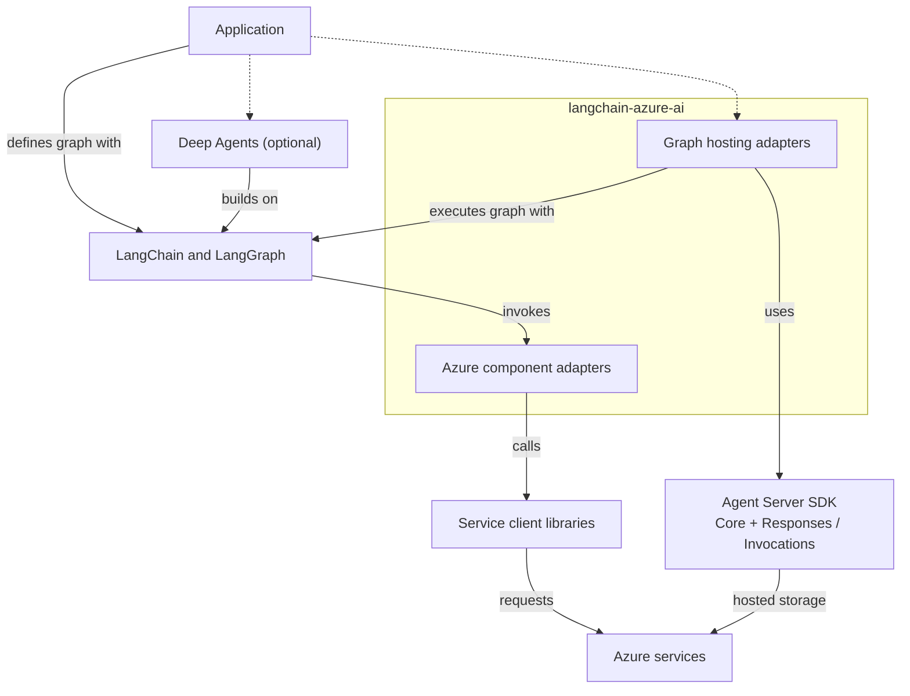

# langchain-azure-ai architecture

`langchain-azure-ai` adapts Microsoft Foundry and Azure services to LangChain
and LangGraph interfaces. This document describes the package's component
boundaries, execution paths, state ownership, and testing layers. Detailed
behavior and acceptance cases belong in the corresponding feature designs.

## System boundaries

Applications compose the integrations they need. A model, retriever, loader,
or tool can run directly, inside a LangChain agent, or as part of a LangGraph
workflow. Hosting exposes an application graph through an HTTP protocol.

The diagram shows composition and service use. Dashed arrows mark optional
application choices.

| Layer | Responsibility |
| --- | --- |
| Application | Select models and tools; define prompts, graph topology, middleware, persistence, and deployment configuration. |
| Deep Agents (optional) | Build on LangChain and LangGraph with planning, subagents, filesystem backends, context management, and skills. Applications can use this package's models, tools, middleware, and Toolbox skills with it. |
| LangChain and LangGraph | Define component interfaces, messages, agent loops, graph execution, interrupts, and checkpoint contracts. |
| `langchain-azure-ai` | Resolve service configuration; adapt requests, results, events, and state to those interfaces; connect graphs to the hosting protocols. |
| Agent Server SDK (`hosting` extra) | Core supplies ASGI serving, request context, storage clients, task infrastructure, and host lifecycle support. Responses and Invocations supply protocol endpoints and handler interfaces. |
| Azure, OpenAI, Anthropic, and MCP client libraries | Provide service clients, authentication hooks, transport, and protocol types used by the adapters. |
| Azure services | Execute remote models, agents, tools, analysis, search, memory, and evaluation operations; retain service-managed data. |

The hosting adapters implement the graph handlers and their input, output,
and execution-state mapping on the Agent Server SDK. See
[Responses hosting](hosting/responses.md) and
[Invocations hosting](hosting/invocations.md) for supported adapter behavior.

## Components

Component links point to their source under `langchain_azure_ai`. Public
package exports are the application entry points; internal modules implement
the adapters.

| Component | Main entry points | Responsibility |
| --- | --- | --- |
| [Chat models](../langchain_azure_ai/chat_models/) | `AzureAIOpenAIApiChatModel`, `AzureAIAnthropicChatModel` | Extend `ChatOpenAI` and `ChatAnthropic` with Foundry endpoint and authentication handling. |
| [Embeddings](../langchain_azure_ai/embeddings/) | `AzureAIOpenAIApiEmbeddingsModel` | Extend `OpenAIEmbeddings` for Foundry configuration and embedding requests. |
| [Agent Service](../langchain_azure_ai/agents/__init__.py) | `AgentServiceFactory`, `ResponsesAgentNode`, `AgentServiceAgentState` | Create or reference remote Foundry agents and compose them as graph nodes, including local tool and approval handling. |
| [Hosting](../langchain_azure_ai/agents/hosting/) | `ResponsesHostServer`, `InvocationsHostServer`, [configuration runner](../langchain_azure_ai/agents/hosting/run.py) | Serve a graph through Responses or HTTP Invocations; translate protocol input, graph output, interrupts, and recovery state. |
| [Checkpoint persistence](../langchain_azure_ai/agents/hosting/_checkpoint/) | `FoundryCheckpointSaver` | Implement the async LangGraph checkpoint contract on Foundry State Store. |
| [Middleware](../langchain_azure_ai/agents/middleware/) | Content Safety middleware, `AzureAIMemoryMiddleware` | Apply service-backed controls at supported agent, model, and tool hooks; synchronize selected messages to Foundry Memory. |
| [Tools](../langchain_azure_ai/tools/) | `AzureAIServicesToolkit`, service tools, `AzureAIProjectToolbox`, `tools.builtin` | Expose local service-calling tools, managed MCP tools and resources, and server-side tool definitions. |
| [Retrieval](../langchain_azure_ai/retrievers/) and [vector stores](../langchain_azure_ai/vectorstores/) | `AzureAISearchRetriever`, `AzureSearch`, `AzureAIMemoryRetriever` | Map searches and memory retrieval to LangChain documents; manage vector ingestion and search through the vector-store interface. |
| [Cache](../langchain_azure_ai/vectorstores/cache.py) | `AzureCosmosDBMongoVCoreSemanticCache` | Reuse model generations through semantic lookup, with entries scoped to the model configuration. |
| [Chat history](../langchain_azure_ai/chat_history/) | `AzureAIMemoryChatMessageHistory` | Wrap transcript storage and forward messages for long-term memory extraction. |
| [Document loading](../langchain_azure_ai/document_loaders/) | `AzureAIContentUnderstandingLoader` | Analyze documents and media, then map content, fields, and source metadata to LangChain documents. |
| [Tracing](../langchain_azure_ai/callbacks/tracers/) | `AzureAIOpenTelemetryTracer`, `enable_auto_tracing` | Convert LangChain callbacks into OpenTelemetry spans and metrics; support explicit callbacks and automatic callback injection. |
| [Evaluation](../langchain_azure_ai/evaluation/) | `FoundryEvaluator`, `FoundryEvaluatorSuite`, evaluation subgraph helpers | Convert evaluation inputs, run Foundry evaluators, interpret results, and compose bounded evaluate/refine loops. |

Shared configuration lives in [`_resources.py`](../langchain_azure_ai/_resources.py)
and [`utils/`](../langchain_azure_ai/utils/). [`_user_agent.py`](../langchain_azure_ai/_user_agent.py)
provides package attribution, and [`_api/`](../langchain_azure_ai/_api/)
provides experimental and deprecation warnings. Several public namespaces
load feature implementations lazily.

The Cosmos DB vector-store, chat-history, NoSQL semantic-cache, and
[query-translator](../langchain_azure_ai/query_constructors/cosmosdb_no_sql.py)
compatibility modules forward to the separate `langchain-azure-cosmosdb` package. That
package also provides graph checkpoint and Store implementations. The
remaining semantic-cache implementation in this package uses its vector-store
client. See the [Cosmos DB package](../../azure-cosmosdb/README.md) for those
components and their installation requirements.

## Primary execution paths

### Calling models and services from a local graph

1. The application creates a component with its endpoint, model or resource
   selection, and credentials.
2. The adapter resolves configuration and constructs or selects a service
   client. Model adapters extend the corresponding LangChain provider classes.
3. LangChain or LangGraph invokes the component. The adapter submits the
   service request and returns messages, documents, embeddings, or tool results.

Local tools execute in the application process and can call remote services.
`tools.builtin` describes tools executed by the model service.
`AzureAIProjectToolbox` discovers tools and resources through a managed MCP
endpoint. Its adapters expose tools to the local agent and can map skills to
Deep Agents files or a backend.

Content Safety and memory middleware participate through agent hooks. Their
position in the execution path determines what they inspect or update. Tracer
callbacks observe component and graph execution.

### Calling a remote Agent Service agent

`AgentServiceFactory` can create an agent definition or reference an existing
agent through `ResponsesAgentNode`.

1. The node converts graph messages to an Agent Service Responses request and
   selects the configured agent version.
2. Agent Service runs the remote agent and its service-side tools. The node
   maps output and pending calls back to graph messages and agent state.
3. A factory-built graph routes local tool calls and MCP approval requests to
   the corresponding nodes, then submits their results to Agent Service.

`AgentServiceAgentState` carries the remote conversation ID, previous response
ID, and pending-call type through graph execution. A graph checkpointer can
persist those fields. Agent Service owns the remote conversation and response
records.

The factory supports agent-boundary and local tool-call middleware hooks.
Model-boundary hooks apply to locally executed models; the remote agent
encapsulates its model interaction. See the
[factory contract](../langchain_azure_ai/agents/_v2/prebuilt/factory.py) and
[Agent Service examples](azure_ai_agents_demo_v2.ipynb).

### Hosting an application graph

The application compiles its graph, configures a checkpointer when needed,
and supplies the graph to a host. The host can create an Agent Server app or
attach to a compatible app supplied by the application.

1. The Agent Server protocol endpoint accepts the HTTP request and establishes
   request context.
2. The hosting adapter validates graph-specific requirements, selects graph
   state, and converts input to messages or an interrupt-resume command.
3. LangGraph executes the graph. The adapter maps output and progress to the
   protocol's response, streaming, and persistence interfaces.

Responses hosting maps graph messages, tool activity, reasoning, citations,
attachments, and usage to Responses items and events. Its converters keep
graph checkpoint references separate from public output. Invocations hosting
provides a text-oriented HTTP contract with structured interrupt replies. Its
direct and task-backed execution paths are selected by host options.

Persistent background recovery composes Agent Server task and protocol state
with LangGraph checkpoints. The adapter selects saved progress and resumes
the graph, or replays input when no progress was saved. Applications own the
replay safety of external effects. Recovery boundaries and supported option
combinations are defined in the protocol-specific hosting documents.

## State and resource ownership

| State or resource | Owner and role |
| --- | --- |
| Graph definition and compiled graph | The application defines topology, state schema, prompts, models, and tools. LangGraph executes it. |
| Graph checkpoints and pending writes | The configured LangGraph saver persists execution state. The application supplies the saver; `FoundryCheckpointSaver` is one implementation. |
| Hosted response or invocation records | Protocol storage retains input, output, status, and execution metadata. Task and replay storage support the configured execution mode. |
| Responses conversation head | `conversation_chain_store` retains the checkpoint reference used for ordinary checkpointed continuation. A branch selects its parent's exact checkpoint. |
| Remote Agent Service conversation | Agent Service retains remote conversation data; the local graph carries the IDs needed for later requests. |
| Chat transcript and long-term memory | A base chat-history implementation owns the transcript. Memory adapters forward selected messages for service-managed extraction and retrieve memories by store and scope. |
| Search indexes and semantic cache entries | Search or database services retain indexed documents, vectors, and cached generations. Adapters define their schema and request mapping. |
| Service clients and credentials | Components hold their configured clients. Their APIs define client reuse and cleanup; Responses hosting also binds storage-client reuse to a request. |

Response storage, graph persistence, transcripts, and long-term memory have
separate purposes and lifetimes. Retaining one does not establish recovery or
retention for the others. See the
[durable state model](hosting/response_resiliency.md#durable-state-model).

State Store-backed adapters use Agent Server's local file storage during local
development and Foundry State Store when hosted. Applications can also supply
other LangGraph savers. See the [storage choices](hosting/responses.md#storage-choices).

Some adapters also hold process-local state. For example, memory middleware
buffers messages and tracks update progress on the middleware instance.
Applications must account for instance reuse when choosing memory scopes and
conversation boundaries.

Hosted graph thread selection uses platform user context when available.
Storage providers and state-store isolation settings participate in the same
boundary. Request-local checkpoint and client reuse must preserve user scope,
checkpoint selection, and durability. See
[request preparation](../langchain_azure_ai/agents/hosting/_responses/request_preparation.py)
and the [storage client scope](../langchain_azure_ai/agents/hosting/_storage/state_store_factory.py).

## Shared configuration and compatibility

Model adapters support Foundry project endpoints and direct service endpoints.
They resolve constructor arguments, environment variables, and credentials
before calling the provider client. OpenAI-based chat and embedding models
share configuration logic; Anthropic models use the Anthropic Foundry client.
Service tools, middleware, and storage adapters have their own endpoint and
credential requirements. Each component's contract defines its precedence and
supported sync and async paths.

The [package manifest](../pyproject.toml) defines dependency ranges and extras.
`hosting`, `tools`, and `opentelemetry` enable the
corresponding integrations. The `v1` extra supports deprecated Agent Service
and inference implementations. Compatibility exports preserve older import
paths while directing applications to current implementations.

Tracing uses the OpenTelemetry provider and exporter configured for the
process. Applications can attach the tracer explicitly or enable automatic
callback injection. Content recording and state recording are separate
controls. Hosting also adds outbound SDK attribution through User-Agent
tokens. Its feature mask combines process registrations and request context;
it should be interpreted according to that scope.

## Testing

Tests verify adapters at their integration boundaries. The test directory name
alone does not establish whether a test uses a live service.

| Layer | What it verifies | External boundary |
| --- | --- | --- |
| [Unit tests](../tests/unit_tests/) | Configuration, conversions, errors, component contracts, and graph/host behavior with deterministic inputs. | Mock service clients or storage as needed; use real LangChain and LangGraph execution where the behavior depends on them. |
| [Integration tests](../tests/integration_tests/) | Adapters composed with SDK and framework interfaces, including tracing, loading, agent, and storage flows. | Individual tests use local implementations, mocks, or recorded HTTP exchanges. New recordings require the relevant service setup. |
| [Process recovery E2E](../tests/e2e_tests/agents/hosting/responses_resilience/README.md) | Response and graph recovery across controlled host-process failures. | A deterministic graph and model isolate recovery behavior; separate runners exercise local processes or a deployed Foundry host. |
| [Docs and samples checks](../../../.github/tests/) | Selected example contracts and imports. | Offline checks with mocked service boundaries; they validate the cases explicitly included in that suite. |
| Live-service validation | Service behavior, authentication, deployment, and platform recovery in a configured environment. | Real Azure resources and service calls; record the environment and tested versions. |

The SDK targets Python 3.11 through 3.14. The current
[ordinary CI matrix](../../../.github/workflows/check_diffs.yml) runs 3.11 and
3.14, with separate unit, integration, and selected docs/sample jobs.
[Quarantined integration tests](../tests/quarantined_integration_tests/)
are outside the ordinary integration-test target. Commands and environment
setup live in the [contribution guide](../../../CONTRIBUTING.md) and
[SDK Makefile](../Makefile).

Each feature design should keep its acceptance cases beside its behavior:
initial state, input or action, expected result, failure or isolation checks,
and links to the implementing tests. Shared test infrastructure can be linked
from this section. The [tracer test matrix](../tests/integration_tests/tracers/README.md)
and recovery E2E guide provide existing examples.

Validation reports should identify the tested revision, Python and dependency
versions, checks run, results, and material coverage limits. Distinguish source
inspection, local or recorded execution, installed-package checks, and live
Azure validation. A passing mock test establishes the behavior at that mocked
boundary.
