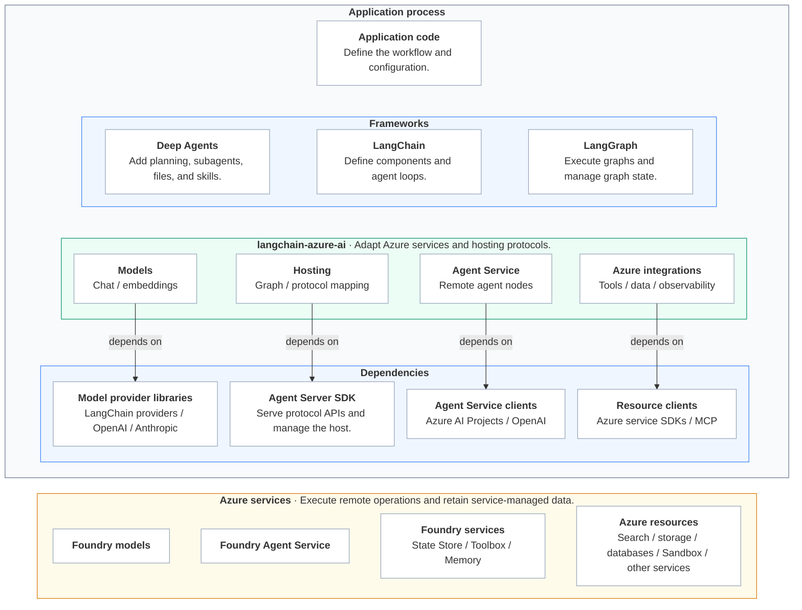
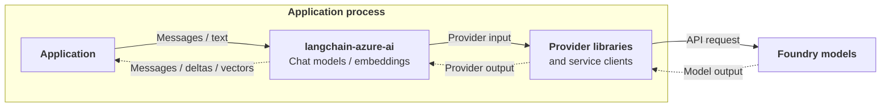
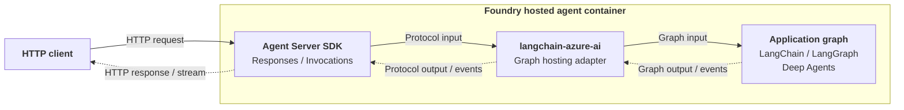

# Overview

`langchain-azure-ai` provides LangChain and LangGraph components to call
Microsoft Foundry models, host agent applications in Foundry, and connect to
Foundry agents and Azure resources. This overview helps contributors understand
component boundaries, dependencies, data flows, and testing layers. Detailed
behavior, configuration contracts, and acceptance cases belong in the
corresponding feature designs.

## System boundaries

The layers group components by responsibility. The process boundary separates
local libraries from remote services. Applications select the components they
need. Deep Agents builds on LangChain and LangGraph. Arrows point from each
adapter to its main library dependencies.

The hosting adapters implement the graph handlers and their input, output,
and execution-state mapping on the Agent Server SDK. See
[Responses hosting](hosting/responses.md) and
[Invocations hosting](hosting/invocations.md) for supported adapter behavior.

## Scenarios and components

The diagrams show how requests and results move through the components.
Solid arrows carry requests or writes; dotted arrows carry results.
Component links point to source under `langchain_azure_ai`. Public package
exports are the application entry points.

### Call Microsoft Foundry models

The application selects a model, endpoint, and credentials. The model adapter
resolves Foundry configuration and uses the corresponding LangChain provider
implementation and service client. Calls return LangChain messages or
embedding vectors. Applications can invoke these components directly or use
them inside an agent.

| Component | Main entry points | Responsibility |
| --- | --- | --- |
| [Chat models](../langchain_azure_ai/chat_models/) | `AzureAIOpenAIApiChatModel`, `AzureAIAnthropicChatModel` | Extend `ChatOpenAI` and `ChatAnthropic` with Foundry endpoint and authentication handling. |
| [Embeddings](../langchain_azure_ai/embeddings/) | `AzureAIOpenAIApiEmbeddingsModel` | Extend `OpenAIEmbeddings` for Foundry configuration and embedding requests. |

### Host applications as Foundry hosted agents

The application supplies a compiled graph with its models, tools, middleware,
and persistence. Agent Server accepts HTTP requests. The hosting adapter
translates between the protocol and the application graph. See
[Responses hosting](hosting/responses.md) and
[Invocations hosting](hosting/invocations.md) for protocol behavior, interrupts,
and recovery.

Graph checkpoints retain execution state, while protocol storage retains request
input, output, and status. See the
[durable state model](hosting/response_resiliency.md#durable-state-model).

| Component | Main entry points | Responsibility |
| --- | --- | --- |
| [Hosting](../langchain_azure_ai/agents/hosting/) | `ResponsesHostServer`, `InvocationsHostServer`, [configuration runner](../langchain_azure_ai/agents/hosting/run.py) | Serve a graph through Responses or HTTP Invocations; translate protocol input, graph output, interrupts, and recovery state. |
| [Checkpoint persistence](../langchain_azure_ai/agents/hosting/_checkpoint/) | `FoundryCheckpointSaver` | Implement the async LangGraph checkpoint contract on Foundry State Store. |

**Installation:** `langchain-azure-ai[hosting]` supplies the hosting dependencies
for the adapters and `FoundryCheckpointSaver`.

### Connect applications to agents and Azure resources

Connect a graph to remote agents, tools, data, and persistence through
LangChain, LangGraph, and Deep Agents interfaces.

| Integration type | Main entry points | Input and result |
| --- | --- | --- |
| [Graph nodes](../langchain_azure_ai/agents/__init__.py) | `AgentServiceFactory`, `ResponsesAgentNode`, `AgentServiceAgentState` | Graph messages go to a remote Foundry agent; response items become graph state updates. The local graph handles local tools and approvals. |
| [Tools, skills and MCPs](../langchain_azure_ai/tools/) | `AzureAIServicesToolkit`, service tools, `AzureAIProjectToolbox`, `tools.builtin` | Tool arguments produce service results. Toolbox supplies MCP tools, resources, and skills; built-in definitions configure server-side tools. |
| [Checkpointers](../../azure-cosmosdb/README.md#langgraph-checkpointer) | `CosmosDBSaver`, `CosmosDBSaverSync` | Persist and load graph checkpoints and pending writes in Cosmos DB. |
| [Stores](../../azure-cosmosdb/README.md#langgraph-store-long-term-memory) | `CosmosDBStore`, `AsyncCosmosDBStore` | Keys, values, and queries write or retrieve data shared across graph threads. |
| [Memory](../langchain_azure_ai/chat_history/) | `AzureAIMemoryChatMessageHistory`, `AzureAIMemoryRetriever`, `AzureAIMemoryMiddleware` | Forward selected messages to Foundry Memory for extraction; retrieve memories by store and scope. The base chat-history implementation owns the transcript. |
| [Vector stores](../langchain_azure_ai/vectorstores/) and [retrievers](../langchain_azure_ai/retrievers/) | `AzureSearch`, `AzureAISearchRetriever` | Documents and vectors populate a search index; queries return LangChain documents. |
| [Semantic cache](../langchain_azure_ai/vectorstores/cache.py) | `AzureCosmosDBMongoVCoreSemanticCache` | Model-scoped semantic lookup returns cached generations or records new ones. |
| [Document loaders](../langchain_azure_ai/document_loaders/) | `AzureAIContentUnderstandingLoader`, `AzureBlobStorageLoader` | Source documents or media become LangChain documents with content and metadata. Content Understanding analyzes inputs; the Blob loader downloads and parses them. |
| [Backends](../../azure-storage/README.md#deep-agents-azure-blob-storage-backend-usage) | `AzureBlobBackend` | Deep Agents file operations read or write workspace files in Blob Storage. |

**Additional dependencies:** `langchain-azure-ai[tools]` supplies SDKs for the
service tools. Toolbox MCP tools and resources require `langchain-mcp-adapters`
and `httpx`; Toolbox skill file mappings also require `deepagents`.

**Separate packages:** Cosmos DB checkpointers and Stores come from
`langchain-azure-cosmosdb`. The Blob document loader and filesystem backend
come from `langchain-azure-storage`.

`ResponsesAgentNode` calls a remote Foundry agent from the application's graph.
`AgentServiceFactory` can create or reference that agent. See the
[Agent Service examples](azure_ai_agents_demo_v2.ipynb).

The graph can also access resources through tools, retrievers, loaders, and
persistence interfaces. Applications can combine this package's components
with a [Cosmos DB checkpointer or Store](../../azure-cosmosdb/README.md), a
[Blob document loader](../../azure-storage/README.md#azure-blob-storage-document-loader-usage),
or other LangChain integrations. Deep Agents can also load Toolbox skills into
its files or backend and use
[`AzureBlobBackend`](../../azure-storage/README.md#deep-agents-azure-blob-storage-backend-usage)
for its file workspace. Checkpoints, long-term memory, source documents, and
workspace files have separate roles. Each package owns its adapters and service
configuration.

The Cosmos DB vector-store, chat-history, NoSQL semantic-cache, and
[query-translator](../langchain_azure_ai/query_constructors/cosmosdb_no_sql.py)
compatibility modules forward to the separate `langchain-azure-cosmosdb` package. That
package also provides graph checkpoint and Store implementations. The
remaining semantic-cache implementation in this package uses its vector-store
client. See the [Cosmos DB package](../../azure-cosmosdb/README.md) for those
components and their installation requirements.

## Shared components

Middleware, observability, and evaluation support applications across the
scenarios above.

| Component | Main entry points | Responsibility |
| --- | --- | --- |
| [Middleware](../langchain_azure_ai/agents/middleware/) | Content Safety middleware, `AzureAIMemoryMiddleware` | Apply service-backed controls at supported agent, model, and tool hooks; synchronize selected messages to Foundry Memory. |
| [Observability](../langchain_azure_ai/callbacks/tracers/) | `AzureAIOpenTelemetryTracer`, `enable_auto_tracing` | Convert LangChain callbacks into OpenTelemetry spans and metrics; support explicit callbacks and automatic callback injection. |
| [Evaluation](../langchain_azure_ai/evaluation/) | `FoundryEvaluator`, `FoundryEvaluatorSuite`, evaluation subgraph helpers | Convert evaluation inputs, run Foundry evaluators, interpret results, and compose bounded evaluate/refine loops. |

**Installation:** `langchain-azure-ai[opentelemetry]` supplies the tracing and
Azure Monitor dependencies. See the [package manifest](../pyproject.toml) for
dependency ranges and extras.

## Testing

Tests verify adapters at their integration boundaries. The test directory name
alone does not establish whether a test uses a live service.

| Layer | What it verifies | External boundary |
| --- | --- | --- |
| [Unit tests](../tests/unit_tests/) | Configuration, conversions, errors, component contracts, and graph/host behavior with deterministic inputs. | Mock service clients or storage as needed; use real LangChain and LangGraph execution where the behavior depends on them. |
| [Integration tests](../tests/integration_tests/) | Adapters composed with SDK and framework interfaces, including tracing, loading, agent, and storage flows. | Individual tests use local implementations, mocks, or recorded HTTP exchanges. New recordings require the relevant service setup. |
| [Process recovery E2E](../tests/e2e_tests/agents/hosting/responses_resilience/README.md) | Response and graph recovery across controlled host-process failures. | A deterministic graph and model isolate recovery behavior; separate runners exercise local processes or a deployed Foundry host. |
| [Docs and samples checks](../../../.github/tests/) | Selected example contracts and imports. | Offline checks with mocked service boundaries; they validate the cases explicitly included in that suite. |
| Live-service validation | Service behavior, authentication, deployment, and platform recovery in a configured environment. | Real Azure resources and service calls; record the environment and tested versions. |

The SDK targets Python 3.11 through 3.14. The current
[ordinary CI matrix](../../../.github/workflows/check_diffs.yml) runs 3.11 and
3.14, with separate unit, integration, and selected docs/sample jobs.
[Quarantined integration tests](../tests/quarantined_integration_tests/)
are outside the ordinary integration-test target. Commands and environment
setup live in the [contribution guide](../../../CONTRIBUTING.md) and
[SDK Makefile](../Makefile).

Each feature design should keep its acceptance cases beside its behavior:
initial state, input or action, expected result, failure or isolation checks,
and links to the implementing tests. Shared test infrastructure can be linked
from this section. The [tracer test matrix](../tests/integration_tests/tracers/README.md)
and recovery E2E guide provide existing examples.

Validation reports should identify the tested revision, Python and dependency
versions, checks run, results, and material coverage limits. Distinguish source
inspection, local or recorded execution, installed-package checks, and live
Azure validation. A passing mock test establishes the behavior at that mocked
boundary.
