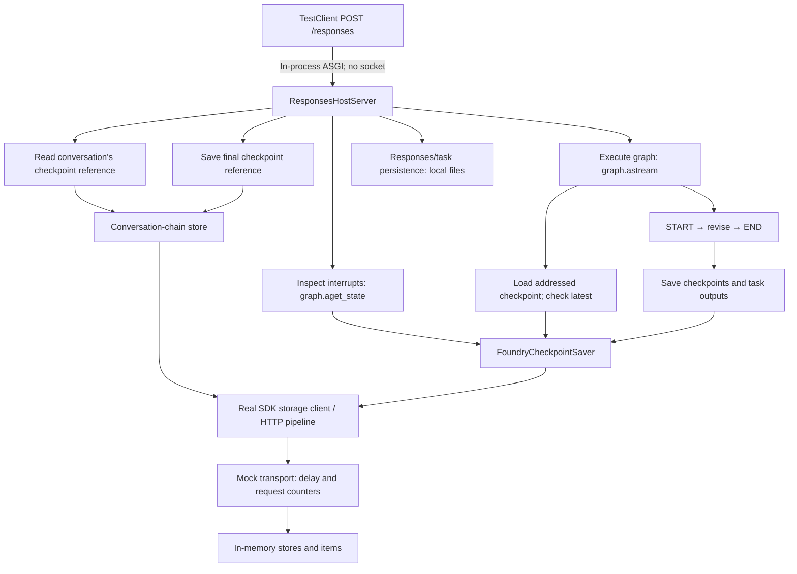

# Checkpoint Storage Analysis

This explains the 2026-10-20 [local baseline](results/RESULTS.md): hosting `d6befba` (`1.2.11`), LangGraph `1.2.16`, AgentServer core `2.2.0` and Responses `2.3.0`. Counts describe this fixture, not every graph or the storage service's internal operations.

The diagram shows call paths; the request stages below give their order. Storage writes can overlap, so the count breakdown is not a serial timing breakdown.

## What runs locally

[`benchmark.py`][setup] builds a one-node graph and compiles it with the real saver, then passes it to `ResponsesHostServer`. [`TestClient(host.app)`][request] enters the application's startup/shutdown lifecycle and sends `POST /responses` directly through ASGI. There is no listening HTTP server, TCP connection or client-to-host network latency.

Only the storage transport and credential are mocked. [Transport injection][inject] selects the SDK's HTTP storage path, preserving saver methods, client construction, request serialization and pipeline execution. [`StorageTransport.send()`][transport] waits for the configured asynchronous delay, dispatches an in-memory operation and records its method, path, status, timing and call ID. [`StorageFixture.dispatch()`][fixture] implements the required store/item routes and rejects external endpoints. Responses/task persistence remains local and is outside these storage HTTP counts.

Skipping storage operations or mocking the saver itself would remove the repeated requests and construction work this diagnostic measures. The injected delay does not model authentication, network pooling, service processing or throttling. No cloud-timeout conclusion follows from these timings.

## State, channels and the two stores

The [`revise` node][node] updates four state channels: `messages`, `files`, `todos` and `turns`. A channel is a state field with its update/reducer behavior. One channel update can contain several messages, files or TODOs; it is not one pending write per individual object. The report file and TODOs here are graph-state values, not files written into a user's workspace.

| Storage | Contents | Purpose |
| --- | --- | --- |
| Conversation-chain store | `langgraph_checkpoint` record containing a checkpoint reference | Map the Responses conversation to graph thread/namespace/checkpoint state. |
| Checkpoint store | Checkpoint snapshots and task/channel pending-write items | Restore graph state and preserve completed task output, errors and interrupt/resume state. |

These use different store names and cannot share a single store-bound handle. Compatible clients may share an underlying connection pool. [Key construction][keys] scopes checkpoints and writes by namespace, checkpoint ID and, for writes, task ID/index.

Pending writes are task outputs associated with a checkpoint, not an accumulated conversation transcript. They are broader than tool results or HITL replies: ordinary state updates and internal routing writes also count.

## Why each store acquisition makes two descriptor GETs

A descriptor contains store settings such as user isolation and item time-to-live (TTL), not checkpoint data.

1. [Core `get_or_create()`][resolve] constructs a store-bound client and resolves its descriptor, creating the store after a not-found response when necessary. It returns the client but discards the fetched/created descriptor result.
2. Hosting fetches the descriptor again to validate isolation/TTL: [saver `_get_or_create_store()`][acquire] or [chain-store `_validate_store()`][chain].
3. The operation reads or writes items, then closes its client. [Core client construction][client] creates the HTTP pipeline; transport injection creates one mock transport for each such client.

For an existing store with no retries, this is two descriptor GETs and one client/transport construction per acquisition. For a new store, the first GET returns 404 and a create request is added. This is distinct from `get_item()`, which reads stored data.

## Continuation: where 38 HTTP requests come from

The second through fourth conversation turns all have the following counts in [each retained run](results/source-baseline.json). Both stores already exist. The request uses a conversation ID, so response-chain history traversal is not part of this fixture's count.

| Stage | Descriptor GET | Item GET | Key-list | Item write | Total | Clients |
| --- | ---: | ---: | ---: | ---: | ---: | ---: |
| Read chain-store checkpoint reference | 2 | 1 | 0 | 0 | 3 | 1 |
| Inspect interrupts | 2 | 1 | 1 | 0 | 4 | 1 |
| Load checkpoint for graph execution | 2 | 1 | 1 | 0 | 4 | 1 |
| Check whether addressed checkpoint is still latest | 2 | 1 | 2 | 0 | 5 | 1 |
| Save three checkpoint snapshots | 6 | 0 | 0 | 3 | 9 | 3 |
| Save two tasks' channel outputs | 4 | 0 | 0 | 6 | 10 | 2 |
| Update chain-store checkpoint reference | 2 | 0 | 0 | 1 | 3 | 1 |
| **Total** | **20** | **4** | **4** | **10** | **38** | **10** |

### Read the checkpoint reference

[`build_runnable_config()`][config] resolves the user-scoped thread and reads `langgraph_checkpoint` through [chain-store `get()`][chain]. This retrieves a reference, not the checkpoint contents: two descriptor GETs plus one item GET. The host then builds graph config with the referenced checkpoint.

### Inspect interrupts

The [handler][host] invokes [`detect_pending_interrupts()`][interrupts], which calls `graph.aget_state(config)`. LangGraph's [state inspection][state] calls [saver `aget_tuple()`][load]. With an explicit checkpoint ID, the saver gets the checkpoint item directly, then [lists its pending writes][pending].

This costs two descriptor GETs, one item GET and one pending-write key-list. In this completed-conversation fixture, that list is empty. The check still runs to decide whether new input should resume a paused graph.

### Load for execution and check latest

The host next starts `graph.astream()`. LangGraph's [execution startup][loop] loads the addressed checkpoint again: another two descriptor GETs, one item GET and one pending-write key-list.

LangGraph 1.2.16 additionally [loads the latest checkpoint][latest] to determine whether the explicitly addressed checkpoint has been superseded. This needs a latest-key lookup before fetching that checkpoint, then its pending-write listing: two descriptor GETs, one item GET and two key-list calls.

In this fixture, all three loads select the same checkpoint key. Together with the chain-store reference read, that explains four item GETs. Equality here does not establish that addressed checkpoints are always current. Request-scoped reuse requires the exclusive-thread/freshness contract in [proposal 3](specs/CHECKPOINT_READS.md); it must preserve interrupt and latest-checkpoint semantics.

### Execute and persist

The graph is `START → revise → END`. Supplemental zero-delay tracing of saver calls confirmed three `aput()` snapshot saves (one input, two loop checkpoints) and two `aput_writes()` calls:

| Saver call | Channel outputs | Item writes |
| --- | --- | ---: |
| Input task `aput_writes()` | `messages`, `branch:to:revise` | 2 |
| `revise` task `aput_writes()` | `messages`, `files`, `todos`, `turns` | 4 |
| Three `aput()` calls | Serialized checkpoint snapshots | 3 |

[`aput()`][save] writes one checkpoint item. [`aput_writes()`][write] writes one item per channel output, preserving ordinary-output deduplication and special-channel replacement rules. These five acquisitions cost ten descriptor GETs and nine item writes. The host currently selects synchronous durability; fewer writes must not be obtained by silently discarding recovery data.

After graph execution, the [host updates the chain-store reference][finish] to the saved checkpoint: two descriptor GETs and one item write. That produces the tenth item write and tenth client acquisition. A final reference must not advertise state whose required persistence has failed.

## First turn and fresh-conversation control

Both have 33 requests: 18 descriptor GETs, two store creates, one item GET, two key-list calls and ten item writes, with nine clients. The chain-store reference item is absent, so its read returns 404. The two initial graph state loads find no checkpoint, so neither reads a checkpoint item or lists pending writes. There is no addressed-checkpoint supersession lookup. Two new stores add the create requests. Graph output and reference persistence still produce ten item writes.

The fresh-conversation control uses warm compute but empty state. It helps distinguish conversation continuation costs from compute reuse; it does not measure Azure container startup.

## Separate pending-write read probe

[`pending_probe()`][probe] directly exercises the saver, outside the TestClient/Responses request. It creates a checkpoint and seeds task outputs before timing, then measures one exact `aget_tuple()` load. Preparation writes are excluded.

| Measured operation, 24 outputs | Requests |
| --- | ---: |
| Resolve and validate store descriptor | 2 |
| Read checkpoint item | 1 |
| List matching pending-write keys | 1 |
| Read 24 pending-write items, serially | 24 |
| **Total** | **28** |

The 24-output probe represents a chosen upper-range test workload, not a measured production percentile or a framework maximum. It uses 24 different tasks with one output each. Multiple channels per task can also produce many logical outputs, but task packing affects those two shapes differently. Normal continuation has zero pending-write items at the selected checkpoint, so it cannot measure the benefit of parallel item restoration. The [105-output probe](results/source-pagination.json) is a pagination correctness control: two pages and 106 item GETs, totaling 110 requests including metadata.

## Tags already select the right records

The saver writes and queries pending-write tags `kind=write`, `ns=<namespace>` and `ckpt=<checkpoint_id>`. [`_pending_writes()`][pending] therefore lists only the selected checkpoint's records. It does not download all prior history. Latest-checkpoint lookup similarly filters checkpoint kind and namespace, with descending creation order and limit one.

State Store [tags filter keys with AND conditions][tags]; listing returns keys only. Once all 24 matching values are needed, there are still 24 `get_item()` calls. Tags are already used correctly. They neither return full values nor batch writes, and their availability does not reveal the service's physical indexing strategy.

## History-depth amplification with DeltaChannel

The local simple graph has 38 requests in each continuation; its count does not grow from turn two to four. The hosted DeepAgent has another path: [messages][delta-messages] and [files][delta-files] use DeltaChannel with a snapshot frequency of 50 updates in DeepAgents 0.7.25. Between snapshots, restoring the channel can require older checkpoint outputs.

LangGraph [detects missing delta state][delta-restore] and calls `aget_delta_channel_history()`. FoundryCheckpointSaver inherits the [base implementation][delta-history], which reads the target and follows `parent_config` one checkpoint at a time until it finds channel seeds. Each tuple load can add metadata, item and pending-write list/value calls. This is repeated reconstruction across history, distinct from loading 24 pending outputs under one checkpoint.

Retained off-mode hosted measurements recorded 98 checkpoint loads over 49 warm empty-history requests (2 per request), versus 5,100 over 50 requests after ten completed turns (102 per request). Logical storage/task call P50 rose from 42 to 579, and request latency P50 from 3.19 to 57.29 seconds. These summaries support the source-level amplification finding; they do not isolate all latency or establish full materialization's net benefit. Response-chain resolution and service variation remain separate contributors.

[Proposal 5](specs/CHECKPOINT_MATERIALIZATION.md) evaluates complete channel state in every newly saved checkpoint while keeping `sync` durability and pending writes. This targets low-cost reconstruction from intermediate as well as final checkpoints. It trades ancestor-read reduction for more serialization, write bytes and storage, subject to the State Store item-size limit. The current local fixture has no DeltaChannel, so a separate delta-history reproduction and matched measurement are required for acceptance. Setting `snapshot_frequency=1` is a comparison, not a guarantee that unchanged channels are materialized at every checkpoint.

## What each proposal can change

These are independent, unimplemented targets; do not sum them without measuring a combined candidate.

| Proposal | Target for this fixture | Boundary |
| --- | --- | --- |
| [1. Descriptor reuse](specs/STATE_STORE_DESCRIPTOR_REUSE.md) | Remove the immediate duplicate GET per acquisition: first/fresh 33 → 24 requests; continuation 38 → 28; 24-write probe 28 → 27. | Preserve per-operation validation; expose the resolved descriptor through a supported core API. |
| [2. Client/transport reuse](specs/STATE_STORE_CLIENT_REUSE.md) | Reuse two store-bound handles rather than create nine/ten per request; share a compatible pool where supported. | HTTP call count stays unchanged if metadata policy is unchanged. Owner closes resources after all work settles, including exceptions/cancellation. |
| [3. Checkpoint reads](specs/CHECKPOINT_READS.md) | Bound parallel pending-write reads; separately evaluate one physical checkpoint load across request inspection/execution. | Parallelism alone does not reduce counts. Read reuse requires freshness, ownership and independent mutable state. Exit-time persistence is a separate durability decision. |
| [4. Pending-write persistence](specs/PENDING_WRITE_PACKING.md) | Two multi-output tasks: six → two write HTTP requests, giving 38 → 34 total continuation requests if everything else is unchanged. | Plan A packs into two items and changes inspection/schema; Plan B requires a service batch API and keeps six items. Neither reduces the one-output-per-task probe's items through task packing. |
| [5. Complete checkpoint materialization](specs/CHECKPOINT_MATERIALIZATION.md) | Avoid ancestor reads for newly saved DeltaChannel state; no reduction is predicted for this non-delta fixture. | Keep sync durability, pending writes and arbitrary-checkpoint recovery; measure larger snapshot bytes/CPU and service limits against fewer history reads. |

The mock proves client-side call structure and checks restored state/closure. It does not demonstrate production latency savings, service reliability, real user isolation or crash recovery. [The result report](results/RESULTS.md) keeps measurements separate from these derived targets.

[setup]: benchmark.py#L117-L128
[request]: benchmark.py#L130-L180
[inject]: benchmark.py#L66-L80
[node]: benchmark.py#L89-L99
[transport]: storage_transport.py#L182-L204
[fixture]: storage_transport.py#L46-L157
[probe]: benchmark.py#L226-L278
[keys]: https://github.com/langchain-ai/langchain-azure/blob/d6befba95a86f55328b2e95eb61151a2f8889485/libs/azure-ai/langchain_azure_ai/agents/hosting/_foundry_checkpoint_saver.py#L554-L573
[acquire]: https://github.com/langchain-ai/langchain-azure/blob/d6befba95a86f55328b2e95eb61151a2f8889485/libs/azure-ai/langchain_azure_ai/agents/hosting/_foundry_checkpoint_saver.py#L429-L460
[chain]: https://github.com/langchain-ai/langchain-azure/blob/d6befba95a86f55328b2e95eb61151a2f8889485/libs/azure-ai/langchain_azure_ai/agents/hosting/_responses/conversation_chain_store.py#L144-L235
[resolve]: https://github.com/Azure/azure-sdk-for-python/blob/f00fb28c5a53593d3dc74d8bebe204e27a604c7f/sdk/agentserver/azure-ai-agentserver-core/azure/ai/agentserver/core/storage/_state.py#L288-L336
[client]: https://github.com/Azure/azure-sdk-for-python/blob/f00fb28c5a53593d3dc74d8bebe204e27a604c7f/sdk/agentserver/azure-ai-agentserver-core/azure/ai/agentserver/core/storage/_client.py#L55-L108
[config]: https://github.com/langchain-ai/langchain-azure/blob/d6befba95a86f55328b2e95eb61151a2f8889485/libs/azure-ai/langchain_azure_ai/agents/hosting/_responses_host.py#L613-L664
[host]: https://github.com/langchain-ai/langchain-azure/blob/d6befba95a86f55328b2e95eb61151a2f8889485/libs/azure-ai/langchain_azure_ai/agents/hosting/_responses_host.py#L872-L960
[interrupts]: https://github.com/langchain-ai/langchain-azure/blob/d6befba95a86f55328b2e95eb61151a2f8889485/libs/azure-ai/langchain_azure_ai/agents/hosting/_converters/_hitl.py#L115-L145
[state]: https://github.com/langchain-ai/langgraph/blob/41c9c22fdc83d68a2859d0c9a2b627c8615a792f/libs/langgraph/langgraph/pregel/main.py#L1489-L1512
[load]: https://github.com/langchain-ai/langchain-azure/blob/d6befba95a86f55328b2e95eb61151a2f8889485/libs/azure-ai/langchain_azure_ai/agents/hosting/_foundry_checkpoint_saver.py#L171-L204
[pending]: https://github.com/langchain-ai/langchain-azure/blob/d6befba95a86f55328b2e95eb61151a2f8889485/libs/azure-ai/langchain_azure_ai/agents/hosting/_foundry_checkpoint_saver.py#L501-L537
[loop]: https://github.com/langchain-ai/langgraph/blob/41c9c22fdc83d68a2859d0c9a2b627c8615a792f/libs/langgraph/langgraph/pregel/_loop.py#L2061-L2090
[latest]: https://github.com/langchain-ai/langgraph/blob/41c9c22fdc83d68a2859d0c9a2b627c8615a792f/libs/langgraph/langgraph/pregel/_checkpoint.py#L191-L200
[save]: https://github.com/langchain-ai/langchain-azure/blob/d6befba95a86f55328b2e95eb61151a2f8889485/libs/azure-ai/langchain_azure_ai/agents/hosting/_foundry_checkpoint_saver.py#L296-L337
[write]: https://github.com/langchain-ai/langchain-azure/blob/d6befba95a86f55328b2e95eb61151a2f8889485/libs/azure-ai/langchain_azure_ai/agents/hosting/_foundry_checkpoint_saver.py#L339-L399
[finish]: https://github.com/langchain-ai/langchain-azure/blob/d6befba95a86f55328b2e95eb61151a2f8889485/libs/azure-ai/langchain_azure_ai/agents/hosting/_responses_host.py#L971-L977
[tags]: https://learn.microsoft.com/en-us/azure/foundry/agents/concepts/agent-state-store?tabs=python#items
[delta-messages]: https://github.com/langchain-ai/deepagents/blob/c6c340d47d2013a2e7b7230698f73977b7de6756/libs/deepagents/deepagents/graph.py#L72-L77
[delta-files]: https://github.com/langchain-ai/deepagents/blob/c6c340d47d2013a2e7b7230698f73977b7de6756/libs/deepagents/deepagents/middleware/filesystem.py#L1297-L1301
[delta-restore]: https://github.com/langchain-ai/langgraph/blob/41c9c22fdc83d68a2859d0c9a2b627c8615a792f/libs/langgraph/langgraph/pregel/_checkpoint.py#L502-L534
[delta-history]: https://github.com/langchain-ai/langgraph/blob/41c9c22fdc83d68a2859d0c9a2b627c8615a792f/libs/checkpoint/langgraph/checkpoint/base/__init__.py#L680-L719
